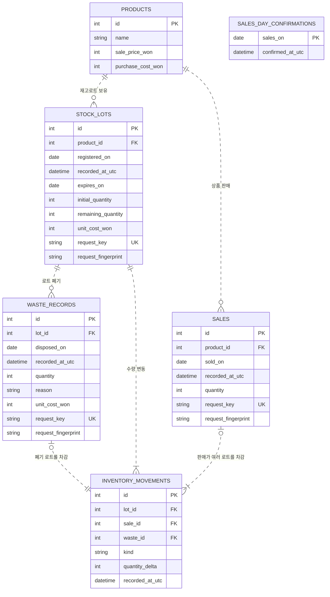

# 논리 ERD와 데이터 모델

[요구사항 명세](../spec.md) · [구현 계획](../plan.md)

## ERD

판매기록 확인은 **점포·날짜 단위**다. 판매건이 없는 날도 확인할 수 있고, 확인하기 전에도 판매건은 존재할 수 있다. 판매와 확인의 업무 연결은 `sales.sold_on = sales_day_confirmations.sales_on`으로 조회한다.

## 테이블과 제약

MySQL 8.4 LTS의 InnoDB 테이블과 `utf8mb4` 문자 집합을 사용한다. ERD의 `int`는 `BIGINT`로 구현하고 PK 식별자는 `AUTO_INCREMENT`를 사용한다. 업무일은 `DATE`, UTC 기록 시각은 `DATETIME(6)`으로 저장한다. 이름과 사유는 `TEXT`, 요청 키는 정규화한 UUID를 `CHAR(36)`, 입력 해시는 16진수 `CHAR(64)`로 저장한다. 변동 유형은 허용 값이 명시된 문자열로 관리한다. 업무일 표시는 `YYYY-MM-DD` 형식이며, 앱 입력 검증과 MySQL 외래 키·`CHECK` 제약을 함께 적용한다.

| 테이블 | 필드와 무결성 |
| --- | --- |
| `products` 상품 | `id`는 내부 상품 식별자다. `name`은 공백을 제외한 문자가 있어야 한다. `sale_price_won > 0`, `purchase_cost_won >= 0`. 상품 이름과 가격을 수정해도 로트·판매·폐기의 연결은 ID로 유지한다. |
| `stock_lots` 재고로트 | 상품은 필수다. `registered_on`은 등록 당시 업무일, `expires_on`은 날짜 또는 기한 없음일 때 `NULL`이다. `initial_quantity > 0`, `0 <= remaining_quantity <= initial_quantity`, `unit_cost_won >= 0`. 등록 때 입력한 원가를 적용하며 비어 있으면 현재 상품 매입원가를 복사한다. 이미 기한이 지난 실물 재고도 로트에 등록해 폐기·이력을 관리할 수 있다. |
| `sales` 판매기록 | 상품, 자동 기록한 점포 업무일 `sold_on`, 양의 정수 `quantity`, UTC 시각을 저장한다. 판매 1건은 로트별 차감 이력 1개 이상과 연결되며 차감량의 합은 판매수량과 일치한다. |
| `sales_day_confirmations` 판매기록 확인 | `sales_on`당 최대 한 행. 행이 있으면 해당 날짜의 기록을 확인한 상태다. 확인을 취소하면 행을 지우고 다시 미확인으로 표시한다. 오늘과 미래 날짜는 확인 대상에서 제외한다. |
| `waste_records` 폐기기록 | 로트, 관리자가 입력한 `disposed_on`, 양의 정수 `quantity`, 비어 있지 않은 `reason`, 차감 당시 로트 원가와 UTC 기록 시각을 저장한다. 폐기일은 로트 등록일 이상이고 오늘 이하다. 상품은 로트에서 확인한다. |
| `inventory_movements` 재고변동이력 | 로트, `kind`, 부호 있는 `quantity_delta`, UTC 기록 시각과 원인 참조를 저장한다. `sale_id`와 `waste_id`는 변동 유형에 따라 하나만 사용하거나 둘 다 비워 둔다. 업무일 조회는 원인에 따라 로트 등록일, 판매일, 폐기일을 사용하고 화면에는 기록 시각도 표시한다. |

카탈로그 가격은 프로모션 계산에 사용한다. 예상 폐기 원가는 로트 원가를 사용하고 실제 폐기 손실은 폐기기록의 단위 원가로 산출한다. 로트의 초기 수량과 적용 원가, 커밋된 판매·폐기·재고변동이력은 등록 이후 고정한다.

| 변동 유형 | 부호와 원인 | 건수 규칙 |
| --- | --- | --- |
| `RECEIPT` 로트 등록 | 양수, 원인은 로트 자체 | 로트당 최초 한 건. 최초 변동량은 초기 수량과 일치한다. |
| `SALE` 판매 | 음수, `sale_id`만 사용 | 한 판매에서 같은 로트 차감은 한 건. 로트의 상품과 판매 상품이 일치한다. |
| `WASTE` 폐기 | 음수, `waste_id`만 사용 | 폐기기록당 한 건. 이력의 로트와 수량이 폐기기록과 일치한다. |

유형별 부호와 참조 조합은 `CHECK`로 검증한다. 로트당 최초 등록 한 건은 `CASE WHEN kind = 'RECEIPT' THEN lot_id ELSE NULL END` 식에 함수형 유일 인덱스를 적용해 강제한다. 판매·로트 쌍과 폐기 한 건은 각각 `UNIQUE (sale_id, lot_id)`와 `UNIQUE (waste_id)`로 보장한다. 원인과 로트의 상품 일치 및 변동 합계는 쓰기 서비스가 트랜잭션 안에서 확인한다. 각 로트의 `remaining_quantity`는 해당 로트의 전체 증감 합계와 일치한다. [MySQL CHECK](https://dev.mysql.com/doc/refman/8.4/en/create-table-check-constraints.html) · [MySQL 함수형·유일 인덱스](https://dev.mysql.com/doc/refman/8.4/en/create-index.html)

**조회 인덱스** — `stock_lots(product_id, expires_on, recorded_at_utc, id)`, `sales(product_id, sold_on)`, `waste_records(disposed_on, lot_id)`, `inventory_movements(lot_id, recorded_at_utc)`. `sales_day_confirmations.sales_on`과 각 등록 요청 키에는 고유 인덱스가 있다.

## 기록 순서와 재고 상태

1. 로트 등록·판매·폐기 서비스는 `READ COMMITTED` 트랜잭션에서 공통으로 해당 상품 행을 PK 기준 `SELECT ... FOR UPDATE`로 먼저 잠근다. 폐기는 로트에서 상품 ID를 확인한 뒤 같은 순서로 잠그고 로트 잔량을 다시 읽는다. 잠금 이후 날짜와 시각을 한 번 읽는다. 로트·판매·폐기에는 각 테이블에서 고유한 `request_key`를 저장한다. `request_fingerprint`는 검증·정규화한 작업 입력의 해시이며 서버가 계산한 시각과 원가 기본값은 입력에서 제외한다.
2. 같은 키와 같은 입력으로 도착한 요청은 기존 처리 결과를 반환한다. 같은 키로 바뀐 입력이 들어오면 충돌로 처리한다. 날짜가 바뀌거나 가격이 수정된 뒤의 재시도도 동일한 입력이면 기존 결과가 반환된다. 서로 다른 상품 요청이 같은 키로 경합해 유일 제약에서 충돌하면, 실패한 트랜잭션을 롤백한 뒤 해당 키의 커밋된 입력과 결과를 다시 확인한다.
3. 판매는 기한이 없거나 소비기한이 업무일 이상인 양수 잔량만 사용한다. 먼저 소비기한이 빠른 로트를 선택하고 같은 기한은 `recorded_at_utc`, `id` 순으로 처리한다. 기한 없는 로트는 마지막에 같은 등록 순으로 처리한다. 전량의 잔량을 잠근 상태에서 검사한 뒤 잔량 조건을 붙여 차감한다. 로트별 차감과 판매·변동 기록은 한 번에 커밋한다.
4. 폐기는 선택한 로트의 실제 남은 수량을 차감한다. 기한이 지난 재고도 폐기할 수 있다. 과거 폐기일은 실제 폐기 손실의 업무일에 사용하고, 수량과 변동이력은 등록 시 한 트랜잭션으로 반영한다.
5. 판매·폐기·등록 중 이력 쓰기에 실패하면 전부 롤백한다. 잠금 대기가 초과되거나 교착 상태가 발생하면 트랜잭션을 정리하고 같은 요청 키로 재시도할 수 있게 알린다. [InnoDB 잠금 읽기](https://dev.mysql.com/doc/refman/8.4/en/innodb-locking-reads.html)

| 현재 상태 | 조건과 조회 |
| --- | --- |
| 보유 | 모든 로트의 남은 양을 합산한다. |
| 판매 가능 | 기한 없음 또는 `expires_on >= D`인 로트의 남은 양을 합산한다. `D`는 요청에서 고정한 점포 현지 날짜다. |
| 소비기한 임박 | 잔량이 있고 `0 <= (expires_on - D) <= 3`이다. |
| 소비기한 경과 | 잔량이 있고 `expires_on < D`이다. 날짜가 바뀌어도 실물 보유량은 유지되고 기록된 폐기에서 차감된다. |

## 조회할 때 계산하는 값

- **판매기록과 수요** — `D-7`부터 `D-1`까지 조회한다. 7일 모두 확인되고 상품의 전체 로트 등록일 중 최솟값이 `D-7` 이하라면 `일평균 = 판매수량 합계 / 7`을 계산한다. 판매기록이 한 건도 없는 확인일은 0이다. 미확인일이나 관찰 기간 부족이 있으면 예측과 사유를 구분해 표시하고, 소비기한 상태는 날짜로 계속 판정한다.
- **장기 미판매** — 판매 가능한 재고가 양수이며 관찰 기간이 충분한 상품에서, 확인된 7일간 판매량이 0이면 표시한다. 확인 가능한 판매가 1개라도 있으면 기간 중 실제 판매가 있었음을 표시하고, 확인일 부족에 따른 예측 보류는 유지한다.
- **로트별 배정** — 현재 판매 가능한 기한 있는 로트를 판매와 같은 순서로 정렬한다. 각 로트의 기한까지의 일수 `n = (expires_on - D) + 1`에 대해 `배정량 = min(로트 잔량, max(0, 일평균 × n - 앞선 로트 누적 배정량))`이다. 조회일을 포함하며, 로트 사이에 같은 수요가 다시 배정되지 않는다. 기한 없는 로트는 장기 미판매를 판정할 수 있다.
- **예상 폐기 원가** — `(로트 잔량 - 예상 배정량) × 로트 적용 원가`로 계산한다. 임박한 로트의 예상 미판매 수량이 양수일 때 폐기 위험으로 표시한다.
- **프로모션 비교** — 판매 가능 폐기 위험 또는 장기 미판매 상품을 상품당 한 건으로 만든다. 폐기 위험이 있으면 가장 가까운 위험 로트의 기한을 우선하고, 장기 미판매만 해당하는 후보는 그다음이다. 같은 우선순위는 상품 ID 순이다. 정상 판매·1+1·2+1의 결제 수량은 1·1·2, 소진 수량은 1·2·3이다. `매출 = 판매가 × 결제 수량`, `원가 = 현재 상품 매입원가 × 소진 수량`, `개당 이익 = (매출 - 원가) / 소진 수량`이다. 행사에 필요한 판매 가능 수량을 충족하고 개당 이익이 양수인 안 가운데 이익이 가장 큰 안을 우선 표시한다.
- **실제 폐기 손실** — 기간과 상품에 해당하는 각 기록의 `폐기수량 × 스냅샷 원가`를 합산한다. 상품 원가를 바꾼 뒤에도 기존 폐기 손실은 기록된 원가 기준이다.

수량과 이익의 분수는 표시 시 최대 소수 둘째 자리까지 반올림한다. 양수 여부와 정상 판매 대비 50% 경계는 반올림 전 값으로 판단한다.
