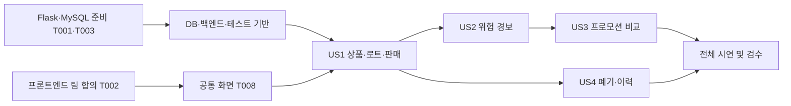

# 작업 목록 — 편의점 단일 점포의 재고 손실 예측 및 프로모션 의사결정 지원

작성일 2026-11-19 · 기능 `001-convenience-store-inventory-risk`

[명세](spec.md) · [구현 계획](plan.md) · [데이터 모델](db/data-model.md) · [화면 계약](front-end/contracts/ui.md) · [설계 근거](backend/research.md) · [검수 가이드](test/quickstart.md)

`[P]`는 공통 선행 작업을 마친 뒤 해당 묶음에서 바로 병렬로 시작할 수 있는 작업이다. `[US1]`~`[US4]`는 명세의 사용자 스토리 번호다. 경로는 GitHub 저장소 루트를 기준으로 한다.

테스트 담당은 [테스트 담당 상세 작업](#테스트-담당-상세-작업)에서 16개 작업의 검수 절차와 통과 조건을 확인할 수 있다.

## 역할과 GitHub 협업

| 역할 | 담당 | 주로 수정하는 경로 |
| --- | --- | --- |
| 백엔드 | MySQL 연결·트랜잭션, 업무 규칙, Flask 라우트, 시연 데이터 명령 | `backend/inventory_app/*.py`, `backend/requirements.txt` |
| 프론트엔드 | 팀 합의 주관, 한국어 화면, 입력·상태·오류 표시 | [팀이 합의한 화면 경로](front-end/contracts/ui.md#팀-결정과-화면별-소스-경로) |
| DB | MySQL 테이블·외래 키·수량 제약·인덱스 설계 및 구현 | `db/schema.sql` (`T004~T005`), [데이터 모델](db/data-model.md) |
| 테스트(CI) | HTTP 화면 계약, DB 상태·동시성 검수, GitHub Actions, 최종 시연 검수 | `test/`, `test/requirements-dev.txt`, `.github/workflows/tests.yml`, [검수 가이드](test/quickstart.md) |

- **협업 시작** — 팀이 사용할 GitHub 저장소의 기본 브랜치에서 명세·계획·계약·작업 목록을 공유한다. Spec Kit 활성 기능은 `spec.md`, `plan.md`, `tasks.md`가 있는 프로젝트 루트(`.`)다. 각 팀원의 로컬 체크아웃에서 설정이 필요하면 프로젝트 루트의 PowerShell에서 `$env:SPECIFY_FEATURE_DIRECTORY = '.'`를 사용할 수 있다.
- **이슈** — 사용자 스토리와 역할 단위로 작업을 배정한다. 이슈 본문에 `T###`, 선행 작업, 담당자, 완료 조건을 적는다. 예를 들어 `US1 백엔드` 이슈에는 `T013, T014, T016`과 `T016`의 화면 선행 조건을 기록한다.
- **브랜치와 PR** — 공통 기반 PR을 먼저 병합한 뒤 `feat/t004-db-schema`, `feat/us1-inventory-backend`, `feat/us1-inventory-frontend`, `test/us1-inventory`처럼 스토리·역할별 브랜치를 쓴다. 역할별 PR은 해당 스토리의 통합 브랜치(예: integrate/us1-inventory)로 보내고, 통합 브랜치에서 전체 테스트가 통과하면 기본 브랜치로 PR을 올린다. PR 본문에 작업 ID, 선행 PR, 수행한 검수와 결과를 적는다. 이슈의 작업을 모두 완료한 기본 브랜치 대상 PR에서 `Closes #번호`를 사용한다. 일부만 완료한 PR은 `Refs #번호`로 참조한다. [GitHub Flow](https://docs.github.com/en/get-started/using-github/github-flow) · [PR과 이슈 연결](https://docs.github.com/en/issues/tracking-your-work-with-issues/using-issues/linking-a-pull-request-to-an-issue)
- **리뷰와 병합** — 프론트엔드와 백엔드는 입력·응답을 함께 확인한다. DB와 백엔드는 스키마와 재고 차감 트랜잭션의 연결을 확인하고, 테스트(CI) 담당은 검수 시나리오와 합격 조건을 검토한다. 앞선 PR을 기다리는 변경은 Draft PR로 공유한다. 선행 PR이 스토리 통합 브랜치에 병합되면 그 변경을 반영하고, 기본 브랜치 대상 통합 PR에서 전체 검수를 실행한다. 테스트에서 의도적으로 실패하는 구간은 브랜치에서 확인하고, 성공을 확인한 통합 상태를 기본 브랜치에 병합한다.
- **공용 파일** — `db/schema.sql`은 DB 담당이 관리한다. `backend/inventory_app/routes.py`와 `backend/inventory_app/inventory.py`의 변경은 백엔드가 스토리별로 합치고, `test/test_web.py`의 변경은 테스트(CI) 담당이 같은 방식으로 합친다. 화면 계약을 바꿔야 하면 두 구현 담당과 테스트 담당이 [화면 계약](front-end/contracts/ui.md)에 변경 내용을 맞춘 뒤 작업한다.

## Phase 1 — 준비 및 프론트엔드 팀 합의

**목표** — Flask·MySQL 준비와 프론트엔드 팀 합의를 병렬로 진행한다.

- [ ] T001 [P] 백엔드 — Python 3.12용 Flask 3.1 계열, `mysql-connector-python`, tzdata를 `backend/requirements.txt`에 등록하고, `.gitignore`에 가상환경·Python 캐시·로컬 비밀 설정 파일을 제외하도록 설정한다.
- [ ] T002 [P] 프론트엔드 — 확정된 React·Tailwind CSS·Vite를 기준으로 백엔드·테스트 담당과 화면별 소스 경로, 로컬 실행·빌드 명령과 접속 주소, Flask 요청·응답 형식, 저장 후 동작과 요청 보호 방식을 합의한다. `front-end/contracts/ui.md`에 결정과 경로를 기록하고 `tasks.md`의 해당 작업에 실제 수정 파일을 적는다.
- [x] T003 [P] 테스트(CI) — `test/requirements-dev.txt`에 `pytest`를 추가하고 `test/test_environment.py`에 MySQL 8.4 테스트 스키마 연결을 확인하는 테스트를 작성한다. 개발·시연 스키마와 구분된 테스트 값을 사용한다.

## Phase 2 — 공통 기반

**완료 조건** — 빈 MySQL 스키마를 초기화할 수 있고 재실행 시 데이터가 보존된다. 백엔드와 테스트 담당은 T002 결정을 기다리는 동안 DB와 서비스 검수를 준비할 수 있다.

- [x] T004 DB — `db/schema.sql`에 상품·로트·판매 테이블을 만들고 [데이터 모델 ERD](db/data-model.md#erd)의 `products.id`, `products.name`, `products.sale_price_won`, `products.purchase_cost_won`, `stock_lots.id`, `stock_lots.product_id`, `stock_lots.registered_on`, `stock_lots.recorded_at_utc`, `stock_lots.expires_on`, `stock_lots.initial_quantity`, `stock_lots.remaining_quantity`, `stock_lots.unit_cost_won`, `stock_lots.request_key`, `stock_lots.request_fingerprint`, `sales.id`, `sales.product_id`, `sales.sold_on`, `sales.recorded_at_utc`, `sales.quantity`, `sales.request_key`, `sales.request_fingerprint`의 [저장 형식과 제약](db/data-model.md#테이블과-제약)을 적용한다.
- [x] T005 DB — T004 뒤 `db/schema.sql`에 날짜 확인·폐기·재고변동 테이블과 공통 조회 인덱스를 만들고 [데이터 모델 ERD](db/data-model.md#erd)의 `sales_day_confirmations.sales_on`, `sales_day_confirmations.confirmed_at_utc`, `waste_records.id`, `waste_records.lot_id`, `waste_records.disposed_on`, `waste_records.recorded_at_utc`, `waste_records.quantity`, `waste_records.reason`, `waste_records.unit_cost_won`, `waste_records.request_key`, `waste_records.request_fingerprint`, `inventory_movements.id`, `inventory_movements.lot_id`, `inventory_movements.sale_id`, `inventory_movements.waste_id`, `inventory_movements.kind`, `inventory_movements.quantity_delta`, `inventory_movements.recorded_at_utc`의 [저장 형식·참조·건수 제약](db/data-model.md#테이블과-제약)을 적용한다.
  - T004·T005를 `main`에 병합하고 T006 초기화 절차를 인계했다. PR 작성자는 별도 MySQL 8.4.13 테스트 스키마에서 60건 통과를 보고했다. [스키마 PR #1](https://github.com/dkfkaf/convenience-inventory/pull/1)
- [ ] T006 백엔드 — DB 담당의 T005 완료 뒤 `backend/inventory_app/db.py`에 요청별 Connector/Python 연결과 `utf8mb4`, `READ COMMITTED` 쓰기 트랜잭션, 명시적 커밋·롤백, 제한된 잠금 대기, 기존 데이터를 보존하는 `init-db`를 구현한다. 초기화 SQL은 `db/schema.sql`을 사용한다.
- [ ] T007 백엔드 — T006 뒤 `backend/inventory_app/__init__.py`와 `backend/inventory_app/routes.py`에 Flask 앱 팩터리, `INVENTORY_DB_*`·시연 날짜 설정, 주입 가능한 점포 시계와 라우트 등록 기반을 만든다. 업무일은 `Asia/Seoul`, 기록 시각은 UTC로 처리한다. 화면 응답 연결은 T002 이후 진행한다.
- [ ] T008 [P] 프론트엔드 — T002 뒤 `front-end/contracts/ui.md`의 공통·오류 항목에 기록한 경로에서 공통 메뉴와 화면 구조, 오류·복귀 경로, 잘못된 입력의 유지·수정 동작을 만든다.
- [ ] T009 [P] 테스트(CI) — T007 뒤 `test/conftest.py`에 `INVENTORY_TEST_DB_NAME`으로 지정한 전용 테스트 스키마, 고정 시계, Flask 앱과 테스트 클라이언트를 pytest 픽스처로 등록한다. `test/helpers.py`에 공통 테스트 데이터 생성 함수를 둔다. `test/test_environment.py`에 InnoDB 외래 키·CHECK와 초기화 재실행 후 기록 보존을 검증한다.
- [ ] T010 테스트(CI) — T003·T009 뒤 `.github/workflows/tests.yml`의 기본 브랜치 대상 `pull_request`에서 Linux 러너와 MySQL 8.4 서비스 컨테이너를 사용한다. DB 준비 뒤 Python 3.12에서 `backend/requirements.txt`와 `test/requirements-dev.txt`를 설치하고 `python -m pytest -v test`를 실행한다.

## Phase 3 — US1 상품 등록과 소비기한별 재고 관리 (P1, 첫 MVP)

**목표** — 상품·로트 관리, 판매 가능 수량 조회, 소비기한이 가까운 로트부터 판매 차감을 지원한다.

**독립 검수** — 이 스토리만으로 S1-1·S1-2·S1-3을 실행한다. 5개와 8개 로트의 합계가 13개이고, 4개 판매는 2개씩 두 로트에서 차감된다. 판매 가능 수량 초과는 잔량과 기록을 변경하지 않는다.

- [ ] T011 [P] [US1] 테스트(CI) — T002 뒤 `test/test_web.py`에서 상품 목록·상세·등록·수정, 로트 등록과 판매 조회·등록의 [화면 계약](front-end/contracts/ui.md)을 검증한다. 저장과 재전송, 필드 오류, 요청 보호, 수량 초과, 판매·로트 이력 표시를 확인한다.
- [ ] T012 [P] [US1] 테스트(CI) — `test/test_inventory.py`에 S1-1~S1-3과 같은 요청 키 재전송, 같은 키의 다른 입력, 동시 판매의 잔량·판매기록·로트 이력 검사를 작성한다. 서로 다른 MySQL 연결로 행 잠금과 동시성을 확인한다.
- [ ] T013 [P] [US1] 백엔드 — `backend/inventory_app/inventory.py`에 상품 등록·수정·조회, 기본 원가 복사, 같은 상품 행 잠금에 따른 로트 등록·재시도와 최초 변동 기록, 보유·판매 가능·기한 경과 집계를 구현한다. FR-INV-01~03.
- [ ] T014 [US1] 백엔드 — T013 뒤 `backend/inventory_app/inventory.py`에서 상품 행을 `SELECT ... FOR UPDATE`로 잠근 뒤 기한·등록시각·ID 순으로 판매 로트를 배정하고 판매·잔량·변동이력을 한 트랜잭션에 기록한다. 상품·기간 필터와 판매별 로트 차감 조회를 제공한다. FR-INV-04~05, FR-WST-02.
- [ ] T015 [P] [US1] 프론트엔드 — T002·T008 뒤 `front-end/contracts/ui.md`의 상품·재고·판매 경로에 화면과 입력 요소를 만든다. 총량 구분, 상품·기간 필터, 로트별 차감과 빈 결과를 표시하고 합의된 변경 요청을 연결할 수 있게 준비한다.
- [ ] T016 [US1] 백엔드 — T002·T014·T015 뒤 `backend/inventory_app/routes.py`에 상품·로트·판매 화면 연동을 구현한다. 합의한 요청·응답 방식으로 서비스 호출, 입력 검증 오류, 재전송, 충돌을 전달한다.
- [ ] T017 [US1] 테스트(CI) — T016 뒤 `test/test_inventory.py`와 `test/test_web.py`를 실행해 S1-1~S1-3, 저장 후 표시되는 판매와 DB 이력, 중복과 수량 초과 처리 결과를 대조한다.

## Phase 4 — US2 폐기 위험과 장기 미판매 조기경보 (P1)

**목표** — 판매기록 확인·취소, 판매 0과 미확인 구분, 상품과 로트별 위험·예측 화면을 제공한다.

**독립 검수** — 확인 상태가 있는 7일치 가상 판매와 로트를 직접 준비해 S2-1~S2-5를 실행한다. 21개 판매는 일평균 3개이며 두 로트 예상 미판매는 각각 2개다. 미확인일에는 0으로 판정하지 않고 자정 후 기한 경과 수량을 별도로 표시한다.

- [ ] T018 [P] [US2] 테스트(CI) — T002 뒤 `test/test_web.py`에서 `POST /sales/day-confirmations`, `GET /sales`의 확인·미확인 표시, `GET /risks`의 필터와 보류 사유를 합의한 계약대로 검증한다.
- [ ] T019 [P] [US2] 테스트(CI) — `test/test_risk.py`에 S2-1~S2-5, 당일 제외 7일, 자정, 임박 3일·4일 경계, 소수 수요가 겹치는 로트와 미확인이어도 판매가 알려진 경우를 작성한다.
- [ ] T020 [P] [US2] 백엔드 — `backend/inventory_app/risk.py`에 지난 판매일 확인·취소와 최근 7일 집계, 관찰 기간 및 확인일 검증, 임박·경과 분류, 같은 상품의 로트별 수요 배정, 예상 폐기 원가·장기 미판매 판정을 구현한다. FR-RSK-01~06.
- [ ] T021 [P] [US2] 프론트엔드 — T002·T015 뒤 `front-end/contracts/ui.md`에 기록한 위험과 판매 화면 경로에 위험 필터·로트별 근거·보류 사유와 날짜 확인 입력을 추가하고, 예상 수치는 표시할 때 반올림한다.
- [ ] T022 [US2] 백엔드 — T020·T021 뒤 `backend/inventory_app/routes.py`에 날짜 확인 변경과 위험 조회를 연결한다. 요청 기준일을 한 번 고정해 확인일 수·판매량·기한·예상량을 같은 기준으로 전달한다. FR-RSK-07.
- [ ] T023 [US2] 테스트(CI) — T022 뒤 `test/test_risk.py`와 `test/test_web.py`를 실행해 S2-1~S2-5 및 SC-02·SC-03을 대조한다. 판매 이력이 없어도 확인된 날과 미확인인 날의 화면 결과가 다름을 확인한다.

## Phase 5 — US4 실제 폐기 반영과 이력 조회 (P2)

**목표** — 선택 로트 폐기, 기간·상품별 실제 손실, 로트의 부호 있는 재고변동이력을 조회한다.

**독립 검수** — 잔량 5개·개당 원가 1,100원인 로트로 S4-1~S4-3을 실행한다. 3개 폐기 후 잔량 2개, 실제 손실 3,300원과 −3개 이력 한 건을 확인한다. 재전송·초과 요청·상품의 현재 원가 변경 뒤에도 기존 결과가 유지된다.

- [ ] T024 [P] [US4] 테스트(CI) — T002 뒤 `test/test_web.py`에서 `GET /waste`, `POST /waste`, `GET /movements`의 변경·조회 계약, 기간 양끝 포함과 빈 합계, 같은 요청 재시도 및 초과 충돌을 검증한다.
- [ ] T025 [P] [US4] 테스트(CI) — `test/test_inventory.py`에 S4-1~S4-3, 판매와 폐기의 동시 차감, 이력 기록 실패 시 롤백, 실제 손실 원가 고정 검증을 추가한다.
- [ ] T026 [P] [US4] 백엔드 — `backend/inventory_app/inventory.py`에서 판매와 같은 상품 행 잠금 순서로 폐기일·사유 검증, 기록 시점 로트 원가 저장, 잔량 차감, 동일 요청 처리, 실제 폐기 손실 집계와 업무일 기준 변동 조회를 구현한다. FR-WST-01~04.
- [ ] T027 [P] [US4] 프론트엔드 — T002·T008 뒤 `front-end/contracts/ui.md`에 기록한 폐기·변동이력 경로에 폐기 입력, 기간 필터, 실제 폐기 손실과 업무일·기록 시각·증감 원인 표시를 만든다.
- [ ] T028 [US4] 백엔드 — T026·T027 뒤 `backend/inventory_app/routes.py`에 폐기 등록과 폐기·전체 변동이력 조회, 원인 기록 경로, 입력 오류·충돌·재시도 응답을 연결한다.
- [ ] T029 [US4] 테스트(CI) — T028 뒤 `test/test_inventory.py`와 `test/test_web.py`를 실행해 S4-1~S4-3, SC-01·SC-05 및 차감 실패 시 부분 기록이 남지 않는지를 확인한다.

## Phase 6 — US3 정상 판매·1+1·2+1 수익성 비교 (P2)

**목표** — 위험 상품의 후보 선별, 개당 매출총이익과 구성 수량 비교, 검토 방향을 제공한다.

**독립 검수** — 위험 판정과 재고, 가격·원가를 가상으로 준비해 S3-1~S3-4를 실행한다. 정상 900원·1+1 −100원·2+1 약 233.33원, 수량 부족·손익분기·정확히 50% 경계, 후보 중복을 검수한다.

- [ ] T030 [P] [US3] 테스트(CI) — T002 뒤 `test/test_web.py`에서 `GET /promotions`와 `GET /promotions/<product_id>`의 후보·비교·사유 표시와 자정이나 잔량 변경 뒤 현재 상태 표시를 검증한다.
- [ ] T031 [P] [US3] 테스트(CI) — `test/test_promotions.py`에 S3-1~S3-4, 위험 기한 정렬과 상품당 한 건, 판매 가능 수량 부족, 반올림 전 50% 경계와 저수익 후보 포함 검증을 작성한다.
- [ ] T032 [P] [US3] 백엔드 — `backend/inventory_app/promotions.py`에서 위험 결과의 후보 선별·정렬, 현재 가격 기준 세 판매 방식의 이익, 구성 가능 여부, 경고와 우선 검토 안을 계산한다. FR-PRO-01~05.
- [ ] T033 [P] [US3] 프론트엔드 — T002·T008 뒤 `front-end/contracts/ui.md`에 기록한 프로모션 경로에 후보 목록, 위험 사유, 판매 방식 비교표, 구성 재고와 검토 유보 표시를 만든다.
- [ ] T034 [US3] 백엔드 — T032·T033 뒤 `backend/inventory_app/routes.py`에 프로모션 목록·상세를 연결한다. 상세를 다시 열 때 판매 가능 수량·위험·가격을 다시 읽어 현재 후보 상태를 표시한다.
- [ ] T035 [US3] 테스트(CI) — T034 뒤 `test/test_promotions.py`와 `test/test_web.py`를 실행해 S3-1~S3-4, SC-04, 후보 목록을 조회한 뒤 재고가 변하는 경우를 검수한다.

## Phase 7 — 전체 검수와 시연

- [ ] T036 [P] 백엔드 — 네 스토리의 DB 동작을 검증한 뒤 `backend/inventory_app/demo.py`와 `backend/inventory_app/__init__.py`에 `seed-demo`를 연결한다. `INVENTORY_DB_NAME`으로 지정한 빈 MySQL 시연 스키마에 `INVENTORY_DEMO_DATE` 기준 가상 자료를 넣어 잔량과 이력을 맞춘다. 기존 데이터가 있는 경우 시드를 거절한다.
- [ ] T037 [P] 프론트엔드 — 네 스토리 화면 연결 뒤 `front-end/contracts/ui.md`에 기록한 공통 화면 경로에서 메뉴, 오류 안내, 키보드 포커스와 금액·수량 표시의 일관성을 확인한다.
- [ ] T038 테스트(CI) — T010·T036·T037과 네 스토리 검수 뒤 `test/quickstart.md`의 Windows 시연을 실행한다. `test/test_inventory.py`, `test/test_risk.py`, `test/test_promotions.py`, `test/test_web.py`의 전체 자동 검수 결과와 SC-01~05를 대조하고 PR 검수에 사용할 결과를 기록한다.

## 의존 관계와 병렬 작업

Flask·MySQL 기반은 T001·T003 뒤 진행한다. 화면 구현과 Flask 화면 연동 검수에는 T002에서 확정한 기술·경로·응답 방식이 필요하다. 준비된 공통 기반을 기본 브랜치에 합친 뒤 첫 MVP를 진행한다. 스토리 번호는 명세의 번호를 유지하며, P2의 폐기 화면은 구현 계획에서 앞선 작업 순서를 반영해 프로모션보다 먼저 나열했다.

| 스토리 | 구현·연결 선행 조건 | 병렬 실행 예시 |
| --- | --- | --- |
| US1 | DB 기반과 DB 테스트의 실패 확인. 화면 연동에는 T002·T008과 화면 계약 검수가 필요하다. | T011·T012는 테스트 파일이 달라 병렬로 준비할 수 있다. 이후 백엔드 T013과 화면 T015를 병렬로 진행한다. T014는 T013 뒤, T016은 T014·T015 뒤다. |
| US2 | US1의 로트·판매와 T002에서 정한 판매 화면, 계약·예측 테스트의 실패 확인 | T018·T019를 준비한 뒤 서비스 T020과 화면 T021을 병렬로 진행한다. 두 결과를 T022에서 연결한다. |
| US4 | US1의 잔량과 변동 처리, 계약·폐기 테스트의 실패 확인 | T024·T025를 준비한 뒤 폐기 로직 T026과 화면 T027을 병렬로 진행한다. T028은 둘을 연결하고 `routes.py`의 앞선 변경을 반영한다. |
| US3 | US2 위험 결과와 US1 가격·재고, 계약·이익 테스트의 실패 확인 | T030·T031을 준비한 뒤 비교 로직 T032와 화면 T033을 병렬로 진행한다. T034가 둘을 연결한다. |
| 전체 | 모든 스토리 검수 | 시연 자료 T036과 화면 확인 T037을 병렬로 진행한 뒤 T038에서 합친다. |

[P] 묶음은 표에 적힌 선행 작업을 완료한 뒤 시작한다. 화면 경로 확정 전에는 백엔드 서비스와 MySQL 테스트를 병렬로 준비하고, 화면과 Flask 연동은 T002의 합의를 반영해서 시작한다. 다른 스토리가 같은 파일을 수정하는 경우 해당 파일의 앞선 PR을 반영한 뒤 작업한다. 예를 들어 `test/test_web.py`는 US1 → US2 → US4 → US3 순으로 PR을 합친다. 필요하면 US4의 폐기 화면을 US2와 함께 준비하되, 공통 테스트·라우터 PR은 한 번에 하나씩 업데이트한다.

## 구현 전략

1. **첫 MVP** — Flask·MySQL 기반과 팀의 프론트엔드 합의를 바탕으로 T001~T017을 완료한 뒤 상품·로트 등록, 판매 차감과 부족 검수를 시연한다.
2. **기능별 검수** — 위험·폐기·프로모션은 각 스토리의 준비된 자료로 독립 검수한다. 연결 작업은 위 의존 관계와 공용 파일의 PR 순서를 따른다.
3. **통합 완료** — 구현과 팀 리뷰를 마친 뒤 전체 자동 검수와 브라우저 시연에서 SC-01~05를 충족한다. 검수한 작업 ID를 PR과 작업 목록에 반영한다.

## 테스트 담당 상세 작업

테스트 담당에게 배정된 **16개 작업**의 준비물, 검증 방법, 합격 조건이다. `T003`은 바로 시작할 수 있고, `T009`는 Flask 앱 팩터리와 DB 연결이 준비된 뒤 진행한다. 화면 연동 테스트는 `T002`에서 팀이 결정한 요청·응답 방식을 사용한다. 그 전에도 시나리오와 MySQL 검수 자료를 준비할 수 있다. [명세의 시나리오](spec.md#사용자-시나리오-및-검수) · [화면 계약](front-end/contracts/ui.md) · [검수 가이드](test/quickstart.md)

### 공통 환경과 GitHub Actions

1. **T003 · 테스트 환경 확인** — `test/requirements-dev.txt`에 `pytest`를 추가하고 `test/test_environment.py`에 연결 검사를 `test_` 함수로 작성한다. `python -m pytest -v test/test_environment.py`로 실행한다. `INVENTORY_TEST_DB_NAME`을 명시하고, 시연·개발용 `INVENTORY_DB_NAME`과 다른지 쓰기 전에 검사한다. 실제 연결에서도 `SELECT DATABASE()`가 지정한 테스트 스키마를 가리키고 MySQL 8.4에 연결되는지 확인한다. 필수 설정이 비어 있거나 연결이 실패하면 원인을 보여주는 실패여야 한다. 값 확인 과정에서 비밀번호는 로그에 찍지 않는다.
2. **T009 · 공통 검수 자료와 DB 제약 검사** — `test/conftest.py`에 테스트별 앱 설정, Flask 테스트 클라이언트, 고정 시계를 `@pytest.fixture`로 등록한다. `test/helpers.py`에 상품·로트·판매 자료 생성 함수를 둔다. 기본 기준일은 `2026-11-18`의 점포 현지 날짜로 두고 자정 테스트에서는 바꿔 쓴다. `test/test_environment.py`에서 존재하지 않는 상품을 참조하는 로트, 음수 잔량 같은 유효하지 않은 쓰기가 거절되고, `init-db`를 다시 실행해도 기존 테스트 기록이 남는지 확인한다. 각 테스트는 자료를 따로 만들고 사용한 연결과 테스트에서 생성한 데이터를 정리한다. 서로 다른 연결에서 커밋하는 동시성 검수에는 전용 스키마와 격리된 테스트 데이터를 사용한다.
3. **T010 · PR에서 자동 검수 실행** — `.github/workflows/tests.yml`에 기본 브랜치 대상 PR, Linux 러너, MySQL 8.4 서비스 컨테이너, Python 3.12 설정을 작성한다. `backend/requirements.txt`가 없으면 사유를 기록하고 pytest 작업을 건너뛴다. 파일이 있으면 MySQL 준비를 확인하고 `backend/requirements.txt`와 `test/requirements-dev.txt`를 설치한 뒤 테스트 전용 연결값으로 `python -m pytest -v test`를 실행한다. 정상 테스트는 성공, 의도적으로 틀린 단언이나 DB 연결 실패는 실패로 표시되는지 확인한다. 로컬과 CI에서 같은 테스트 명령을 사용한다. 첫 MVP의 기본 브랜치 대상 통합 PR에서 T001·T009 기반, T011·T012 테스트, T013·T014 판매 서비스, T016 화면 연동을 함께 반영한 뒤 Checks에서 전체 pytest 통과를 확인한다.

### US1 · 상품·재고·판매

4. **T011 · 화면 연동 계약 테스트** — `test/test_web.py`의 `TestInventoryWeb`에 상품 목록·상세·등록·수정, 로트 등록, 판매 조회·등록을 넣는다. 정상 저장 후 갱신값, 잘못된 필드의 오류, T002로 정한 변경 요청 보호, 판매 가능 수량 초과와 재시도 응답을 확인한다. 상태 코드나 본문 형식의 단언은 합의된 화면 계약에 맞춘다.
5. **T012 · 판매 차감과 이력 검증** — `test/test_inventory.py`의 `TestInventory`에 S1-1~S1-3을 작성한다. 로트 5개와 8개 등록 후 총 13개, 로트 2개와 5개에서 판매 4개를 처리하면 각각 0개와 3개가 남고 판매 한 건에 차감 이력 두 건이 붙는지 확인한다. 기한 경과 3개와 판매 가능 5개가 있는 상태에서 6개 판매를 요청하면 잔량·판매기록·이력 모두 그대로여야 한다. 같은 키와 같은 입력은 한 번만 반영되고 같은 키의 다른 입력은 충돌해야 한다. 동시 판매는 판매 가능 5개에 4개 요청 두 건을 별도 연결로 보내고 최종 판매 성공 한 건, 잔량 1개, 실제 차감 합계 4개를 확인한다. 진행 상태는 테스트 6개 작성·수집 확인이다. T009의 inventory_case 픽스처와 T013·T014 판매 서비스를 연결한 뒤 실제 MySQL에서 실행한다.
6. **T017 · 첫 MVP 검수** — T016 뒤 `python -m pytest -v test/test_inventory.py::TestInventory test/test_web.py::TestInventoryWeb`를 실행한다. S1-1~S1-3 자료로 화면에 보이는 판매 수량과 DB의 판매·로트 이력을 대조한다. 실패 건은 시나리오 ID, 입력, 기대값, 실제값을 기록한 뒤 수정 사항이 반영된 브랜치에서 재실행한다.

### US2 · 소비기한과 장기 미판매 경보

7. **T018 · 판매일 확인 및 위험 화면 테스트** — `test/test_web.py`의 `TestRiskWeb`에 판매일 확인·취소와 위험 조회를 추가한다. `/sales`의 확인 상태와 `/risks`의 위험 종류 필터, 일평균·예상량, 예측 보류 사유를 확인한다. 판매가 한 건도 없는 확인일과 기록이 미확인인 날의 화면 결과를 별도로 비교한다.
8. **T019 · 날짜·수요 계산 검증** — `test/test_risk.py`에 S2-1~S2-5를 작성한다. 직전 7일에 21개 판매했다면 일평균 3개다. 오늘까지인 로트 5개와 이틀 뒤까지인 로트 8개에 각각 3개와 6개가 배정되고, 미판매 2개씩과 예상 폐기 원가 2,200원씩이 나와야 한다. 다음 날 0시의 기한 경과 전환, 임박 기준 3일 포함·4일 제외, 당일 판매 제외, 7일 미확인과 신규 상품 보류도 따로 검증한다. 미확인일이 있어도 알려진 판매가 있는 사례, 기한 없는 상품의 장기 미판매, 같은 날짜 구간에 소수 수요를 배정할 때 중복 계산이 없는 사례를 추가한다. [입력과 기대값 11개](test/fixtures/risk_cases.json)를 준비하고 날짜별 기준 계산으로 교차 확인했다. test/test_risk.py에서 실제 계산 결과와 대조할 작업이 남았다.
9. **T023 · 경보 통합 검수** — T022 뒤 `python -m pytest -v test/test_risk.py test/test_web.py::TestRiskWeb`를 실행한다. S2-1~S2-5, SC-02·SC-03의 계산과 화면 결과를 대조한다. 시연에서 판매일 확인을 취소한 뒤 예측이 보류되고, 기한 알림은 날짜를 기준으로 계속 표시되는지 확인한다.

### US4 · 폐기·이력 및 롤백

10. **T024 · 폐기 화면 계약 테스트** — `test/test_web.py`의 `TestWasteWeb`에서 `GET /waste`, `POST /waste`, `GET /movements`를 검증한다. 기간의 시작·종료일 포함, 빈 목록 합계 0, 사유·수량 오류, 같은 요청 재시도와 잔량 초과 충돌을 확인한다.
11. **T025 · 폐기 트랜잭션 검증** — `test/test_inventory.py`의 `TestWaste`에 S4-1~S4-3을 추가한다. 로트 원가 1,100원과 잔량 5개에서 3개 폐기 후 잔량 2개, 이력 −3개 한 건, 손실 3,300원을 확인한다. 동일 요청 재전송과 별도 3개 폐기 요청은 추가 차감이 없어야 하고, 상품 원가를 1,400원으로 변경해도 과거 손실은 3,300원이어야 한다. 판매와 폐기가 같은 재고를 동시에 변경하는 경우 잔량이 음수가 되지 않고 성공한 요청과 이력이 일치하는지 확인한다. 이력 저장 단계에서 오류를 유도한 경우에는 새 연결로 DB를 읽어 차감과 원인 기록이 함께 롤백됐는지 확인한다. [입력과 기대값 6개](test/fixtures/waste_cases.json)를 준비하고 재고·기록·손실의 예상 상태를 기준 계산과 대조했다. T026 폐기 기능을 연결한 뒤 동시 요청과 롤백을 실제 MySQL에서 검증한다.
12. **T029 · 폐기 통합 검수** — T028 뒤 `python -m pytest -v test/test_inventory.py::TestWaste test/test_web.py::TestWasteWeb`를 실행한다. S4-1~S4-3, SC-01·SC-05에 맞춰 폐기·실제 손실·변동이력 화면과 DB 기록을 대조한다.

### US3 · 프로모션 후보와 수익성

13. **T030 · 행사 비교 화면 테스트** — `test/test_web.py`의 `TestPromotionWeb`에서 `GET /promotions`와 `GET /promotions/<product_id>`를 검증한다. 위험 사유, 세 비교안, 구성 가능 여부와 검토 유보가 보이는지 확인한다. 후보 화면을 본 뒤 판매 가능 재고가 바뀌면 상세에서 현재 수량과 상태를 표시해야 한다.
14. **T031 · 계산·경계값 검증** — `test/test_promotions.py`에 S3-1~S3-4를 작성한다. 판매가 2,000원·원가 1,100원일 때 개당 이익은 900원·−100원·약 233.33원이다. 판매 가능 6개에서는 2+1 검토와 저수익 경고, 2개에서는 2+1 구성 부족과 검토 유보를 확인한다. 별도 입력으로 손익분기 0원과 정상 이익의 정확히 50%를 검증한다. 폐기 위험과 장기 미판매가 겹쳐도 후보는 상품당 한 건이고, 판매 가능 재고 0은 후보에서 제외된다. 가장 가까운 위험 기한 순서도 검사한다. [입력과 기대값 9개](test/fixtures/promotion_cases.json)를 준비하고 정확한 분수 계산과 후보 정렬을 교차 확인했다. T032 프로모션 서비스와 연결해 pytest로 검증할 작업이 남았다.
15. **T035 · 비교 화면 통합 검수** — T034 뒤 `python -m pytest -v test/test_promotions.py test/test_web.py::TestPromotionWeb`를 실행한다. S3-1~S3-4 및 SC-04에서 계산값, 경고와 검토 방향을 대조하고 기한·수량·가격 변경 뒤 최신 기준이 쓰이는지 확인한다.

### 전체 시연

16. **T038 · 최종 시연 검수** — 네 스토리와 시연 데이터가 합쳐진 뒤 전체 테스트 명령 `python -m pytest -v test`를 로컬과 GitHub Actions에서 실행한다. [검수 가이드](test/quickstart.md)로 브라우저 시연을 진행해 **SC-01~05**를 대조하고, 테스트 스키마와 시연 스키마를 구분한다. PR에는 커밋 또는 검수 대상, 실행 명령, 통과·실패 시나리오 ID, 실패 시 재현 입력과 기대값·실제값을 남긴다.

### 테스트 도구 결정 · pytest

| 비교 항목 | `unittest` | `pytest` |
| --- | --- | --- |
| 설치와 실행 | Python 표준 라이브러리에 포함 | `test/requirements-dev.txt`로 설치. `python -m pytest -v test` |
| 테스트 작성 | `TestCase` 클래스와 `self.assertEqual` 등의 메서드 | 테스트 함수에서 `assert` 사용. 실패 비교에서 입력과 결과 차이를 확인하기 편하다. |
| MySQL·Flask 준비 자료 | `setUp`, `addCleanup`과 `test/helpers.py`로 재사용 | `@pytest.fixture`를 테스트 함수 인자로 받아 DB 연결·클라이언트·고정 시계를 필요한 테스트에 재사용하기 편하다. |
| 여러 경계값 반복 | 반복문과 `subTest()`로 확인한다. | `@pytest.mark.parametrize`로 재고 2개·6개, 기한 3일·4일, 개당 이익 경계를 각각 수집하고 표시한다. |

**테스트 도구는 `pytest`로 확정한다.** MySQL 테스트 데이터와 Flask 클라이언트는 픽스처로 재사용하고, 금액·기한·수량 경계값은 `@pytest.mark.parametrize`로 검증한다. 로컬과 GitHub Actions에서 `python -m pytest -v test`를 실행한다. [pytest 픽스처](https://docs.pytest.org/en/stable/how-to/fixtures.html) · [pytest 반복 입력](https://docs.pytest.org/en/stable/how-to/parametrize.html)
